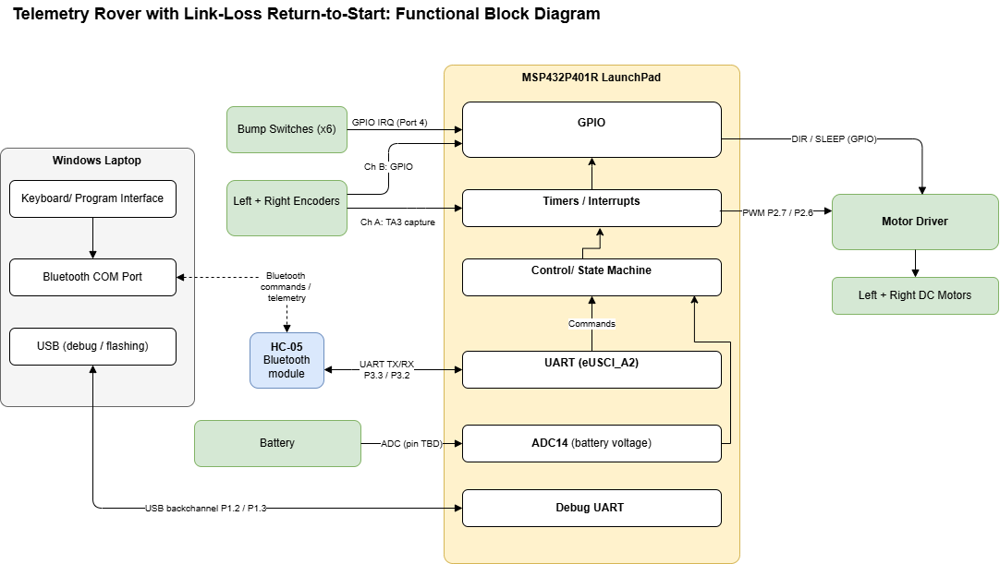

# ECE_528_Final-Project_Proposal

**Project title:** Telemetry Rover with Link-Loss Return-to-Start

## Objective

This project is to control the TI-RSLK MAX development kit over Bluetooth, using our laptop as the controller, with the robot/rover implemented so that it handles its own safety, with Built-In Test, Basic Health Reporting, Communcation Error Checks, and other telemetry data sent back. Along with this, the rover has a "Link-Loss Return-to-Start" feature, so that if there is a loss in connection, the rover will begin to drive back/return to its initial position autonomously.   

## Background and Methodology

### Concepts applied

The key concepts expected to be applied involve implementing multiple peripherals/concepts into one cohesive system, such as GPIO, PWM generation, timers/interrupts, UART communication over Bluetooth, ADC (battery monitoring), sensor input (encoders and bump switches), closed-loop PI motor control with encoder odometry, Built-In Test and telemetry monitoring, and finite state machines.

### Expected outcome

The expected outcome is a cohesive system that is driven from a laptop keyboard, with live telemetry shown on screen and logged to CSV. It includes safety features such as stopping on loss of connection or when a bump switch is triggered. If the communication link stays lost, the robot then enters a "return/recovery" state, in which it drives itself autonomously back near its start point, with the return error measured over repeated runs. Battery and stall conditions are also detected and reported to the laptop.

### Overall plan

---
**Weekend 1: Bring-up and link**
- Port lab drivers (clock, motor PWM, GPIO) and verify pin assignments on the RSLK MAX.
- Build an interrupt-driven UART driver, and configure and pair the HC-05 Bluetooth module.
- Implement the packet format and parser.
- Write the laptop C program for keyboard control and sending drive commands.
- Add a link-loss stop and a bump-switch interrupt stop.

**Milestone:** Rover drives from the laptop over Bluetooth and stops on its own on link loss or bump.

---
**Weekend 2: Control and autonomy**
- Implement encoder capture: measure wheel motion to determine speed and direction.
- Implement PI speed loops: make the wheels do what we command.
- Implement odometry: track the position the rover has traveled.
- Implement drive-to-point: give it a point and it drives there.
- Add return-to-start after the link is lost.

**Milestone:** Rover holds commanded wheel speeds and drives itself back near its start point after link loss.

---
**Weekend 3: Health monitoring**
- Implement Built-In Test features: voltage/battery monitoring, wireless connection check, and motor checks.
- Implement the full state machine for the rover.
- Implement health status reporting in telemetry.

**Milestone:** All features working, with test results logged to CSV.

---
**Weekend 4: Documentation and clean-up**
- Clean up code and comments; finalize the GitHub repo.
- Complete the write-up.

**Milestone:** Deliverables complete.

---

### Hardware and software components

- Hardware: TI-RSLK MAX (MSP432P401R LaunchPad, motors, encoders, bump switches), HC-05 module, Windows laptop.
- Firmware: C in Code Composer Studio
- Laptop program: C (Windows console), keyboard control + CSV logging.
- Version control: GitHub.

### Peripherals used

- GPIO, Timer_A (PWM, input capture, periodic tick), SysTick, eUSCI UART (×2: HC-05 and USB debug), ADC14, NVIC interrupts.

## Block Diagram

## Pinout Plan

RSLK pins below are from the lab curriculum and still need checking against the techical mannual .

| Function | Pin(s) | Peripheral | Note |
| --- | --- | --- | --- |
| Motor PWM L / R | P2.7 / P2.6 | Timer_A0 | Verify (PWM lab) |
| Motor direction L / R | P5.4 / P5.5 | GPIO | Verify |
| Motor sleep L / R | P3.7 / P3.6 | GPIO | Verify |
| Encoder A L / R | P10.5 / P10.4 | Timer_A3 capture | Verify |
| Encoder B L / R | P5.2 / P5.0 | GPIO | Verify |
| Bump switches | P4.0, 4.2, 4.3, 4.5, 4.6, 4.7 | GPIO interrupt | Verify |
| HC-05 RX / TX | P3.2 / P3.3 | eUSCI_A2 UART | Verify |
| HC-05 power | 5 V / GND | — | Verify |
| Debug UART | P1.2 / P1.3 | eUSCI_A0 | USB backchannel |
| Battery sense | TBD | ADC14 | Check for this  |
| Status LED | P2.0–P2.2 | GPIO | LaunchPad RGB |

